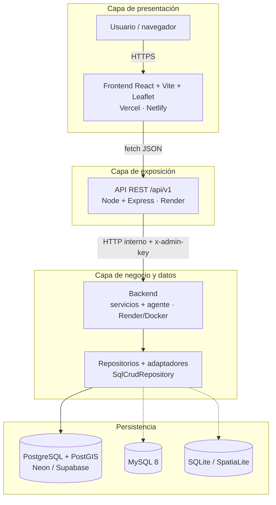
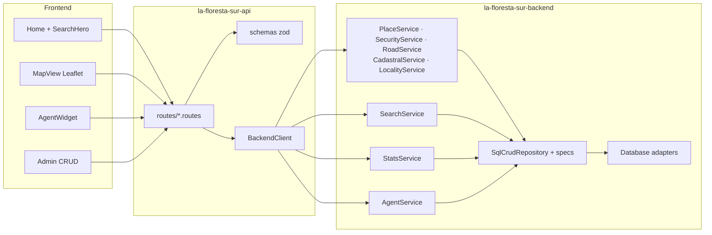
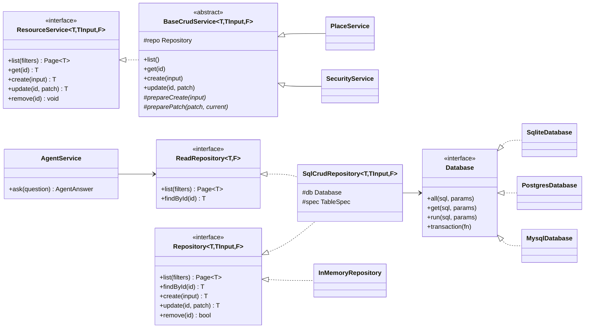
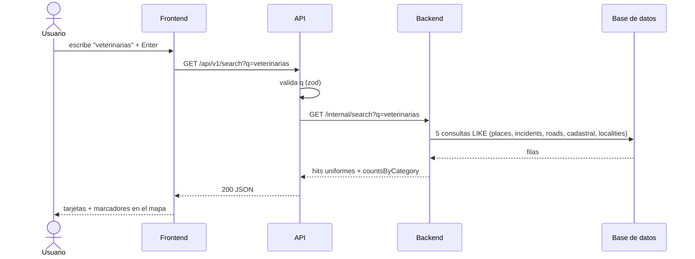
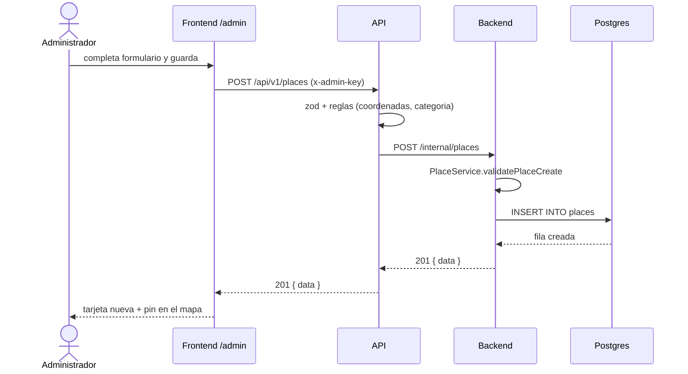
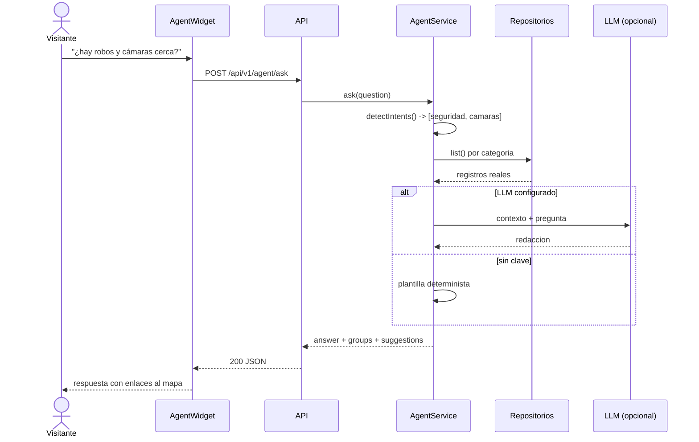

# Arquitectura y diagramas UML

## 1. Principios

- **Capas:** presentación (frontend) → exposición (API) → negocio/persistencia (backend).
- **SOLID:** puertos y adaptadores; el dominio no importa Express, `pg` ni `mysql2`.
- **Archivos ≤ 100 líneas:** verificado en CI.

| Principio | Dónde se ve |
| --- | --- |
| SRP | Un validador, un mapper, un repositorio por entidad |
| OCP | Nuevo motor = nuevo adaptador `Database`; nuevo recurso = nuevo spec + servicio |
| LSP | `SqlCrudRepository` y `InMemoryRepository` cumplen `Repository` |
| ISP | `ReadRepository` (solo lectura) vs `Repository` (CRUD) |
| DIP | `PlaceService` recibe `Repository`; `buildContext` inyecta SQLite/PG/MySQL |

## 2. Diagrama de despliegue (3 capas + ORM)



## 3. Diagrama de componentes



## 4. Diagrama de clases (SOLID)



## 5. Secuencia: búsqueda



## 6. Secuencia: CRUD de un lugar



## 7. Secuencia: pregunta al agente de IA



## 8. Flujo de datos y despliegue

```text
git push -> GitHub Actions (check 100 líneas, tipos, tests, build)
         -> Render (Docker) backend + API
         -> Vercel/Netlify frontend
         -> Neon/Supabase PostgreSQL (o SQLite persistente en Render Disk)
```
